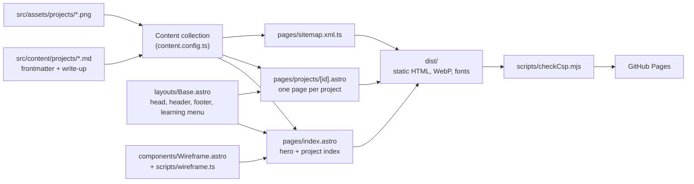

# Portfolio

Clark Hinchcliff's portfolio, live at https://clarkgh.github.io.

## Table of Contents

- [Overview](#overview)
- [The big picture](#the-big-picture)
- [Principles](#principles)
- [Commands](#commands)
- [Navigation](#navigation)

## Overview

A static [Astro](https://astro.build) site: a home page with a hero and a project index, one page per project, and a side sheet of free learning resources behind a menu button. Every page is HTML at build time. The only JavaScript runs the theme toggle, the menu, and the WebGL wireframe in the hero.

It's small, but a few parts aren't obvious from the code alone: the wireframe's math and animation loop, how a Content Security Policy works on a host that can't send headers, and the handful of tricks that keep Lighthouse happy. These docs cover the why. The code covers the what.

Code snippets in these docs show the idea. They aren't always line-for-line copies of the code.

## The big picture

## Principles

- **Static first.** Everything that can be decided at build time is: pages, image sizes, font files, CSP hashes.
- **Accessible by default.** WCAG 2.2 AA is the floor, not a feature. See [site-shell.md](site-shell.md#accessibility) and [wireframe.md](wireframe.md#rules-it-follows).
- **No third parties at runtime.** Fonts are self-hosted, and there are no analytics, embeds or CDNs. That keeps the CSP short and visitors private.
- **Hand-written where it teaches something.** The wireframe's matrix and quaternion math is written out instead of pulled from a library, on purpose.
- **YAGNI.** No dependency, abstraction or test that isn't paying for itself today.

## Commands

| Command | What it does |
| --- | --- |
| `pnpm dev` | Dev server at http://localhost:4321 (the CSP is off in dev, see [security.md](security.md#testing-it)) |
| `pnpm test` | Unit tests (Vitest), colocated `*.spec.ts` |
| `pnpm build` | Tests, then `astro check`, then the static build into `dist/`, then the CSP check |
| `pnpm preview` | Serves `dist/` (the closest thing to production) |

## Navigation

- **[Project Structure](project-structure.md)** - Where every file lives and why, plus testing
- **[Site Shell](site-shell.md)** - The layout: theme, header, footer, learning menu, accessibility
- **[Wireframe](wireframe.md)** - The hero icosahedron: math, rendering, motion and input
- **[Content](content.md)** - Projects as Markdown, screenshots, alt text, adding a project
- **[Performance and SEO](performance-seo.md)** - Fonts, images, CSS, metadata, sitemap, deploy
- **[Security](security.md)** - CSP, referrer policy, external links, the CSP check
