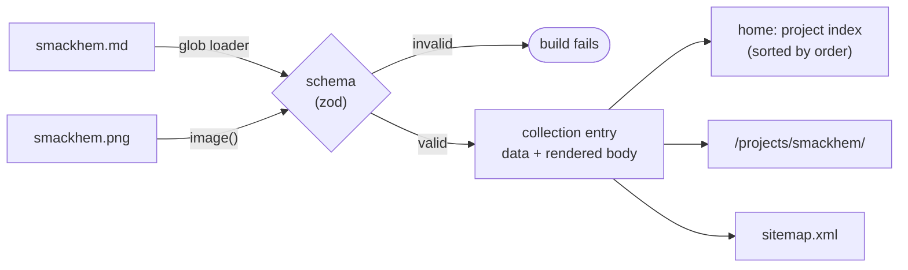

# Content

Projects are Markdown files with frontmatter. Astro validates them against a schema at build time, so a missing field or a screenshot without alt text fails the build instead of shipping.

## Table of Contents

- [Where it lives](#where-it-lives)
- [The big picture](#the-big-picture)
- [Adding a project](#adding-a-project)
- [The schema](#the-schema)
- [Screenshots](#screenshots)
    - [Writing alt text](#writing-alt-text)
- [Technical details](#technical-details)
- [Where a project shows up](#where-a-project-shows-up)
- [Rules it follows](#rules-it-follows)
- [Not built yet](#not-built-yet)
- [Navigation](#navigation)

## Where it lives

| File | Job |
| --- | --- |
| [content.config.ts](../src/content.config.ts) | The `projects` collection: loader and schema |
| [src/content/projects/](../src/content/projects/) | One `.md` per project. The filename is the URL slug |
| [src/assets/projects/](../src/assets/projects/) | Screenshots, referenced from frontmatter |
| [index.astro](../src/pages/index.astro) | The project index on the home page |
| [[id].astro](../src/pages/projects/[id].astro) | One page per project |
| [sitemap.xml.ts](../src/pages/sitemap.xml.ts) | Lists the home page and every project page |

## The big picture



## Adding a project

1. Add `src/content/projects/my-project.md`. The filename becomes `/projects/my-project/`.
2. Optionally add a screenshot to `src/assets/projects/` (a 16:10 crop looks best).
3. Fill in the frontmatter:

```md
---
title: My Project
summary: One sentence, shown on the home page and as the page's meta description.
repo: https://github.com/ClarkGH/my-project
stack: [TypeScript, Vite]
status: active        # active | paused | experiment | done
image: ../../assets/projects/my-project.png
imageAlt: What the screenshot shows, in a sentence.
order: 6              # lower shows first
---

The write-up, in Markdown. Use ## for sections: the page title is the only h1.
```

4. Add the new files to the tree in [project-structure.md](project-structure.md#project-directory-structure), or `pnpm test` goes red.
5. Run `pnpm build`. The schema, the specs and the CSP check all run.

## The schema

| Field | Type | Notes |
| --- | --- | --- |
| `title` | string | The page `<h1>` and the index heading |
| `summary` | string | Shown in the index, and used as the meta and social card description |
| `repo` | URL | "View the source on GitHub" |
| `stack` | string[] | Shown as a comma-separated italic line |
| `status` | enum | `active`, `paused`, `experiment` or `done` |
| `image` | image, optional | A path relative to the `.md` file. `image()` makes Astro import and process it |
| `imageAlt` | string, optional | **Required whenever `image` is set**, enforced by a `.refine()` on the schema |
| `order` | number | Sort order on the home page, default 100 |

The first project by `order` is the lead, with a bigger title and summary.

## Screenshots

Screenshots live in `src/assets/` (not `public/`), so Astro can process them. At build time each one becomes:

- **On the home page:** WebP at 240 and 480px wide, with `sizes` matching the thumbnail's CSS width (7.5rem on phones, 15rem from 48rem up). They're `loading="lazy"`.
- **On the project page:** WebP at 480, 840 and 1280px, loaded eagerly with `fetchpriority="high"`, because the screenshot is often the largest thing on screen (the LCP element).
- **As the social card:** a JPEG up to 1200px wide, since not every link unfurler reads WebP. See [performance-seo.md](performance-seo.md#social-cards).

Astro never upscales, so a small source just yields fewer sizes. Width and height come from the file, so images never shift the layout.

### Writing alt text

Alt text is for someone who can't see the image. Describe what's in the screenshot in one plain sentence, the way you'd describe it over the phone:

- **Do:** "The Vue todo app: a box for adding todos, then four todos with Edit and Delete buttons, two of them checked off."
- **Don't** start with "Image of" or "Screenshot of" (screen readers already say it's an image), and don't repeat the project name the page's heading already gives.
- **Don't** put the meaning only in the image. If the screenshot shows something the write-up depends on, say it in the text too.

The home page thumbnails use `alt=""` on purpose: they're hidden duplicates of the title link, so describing them would mean hearing everything twice.

## Technical details

A project page is written for two readers: someone who isn't an engineer, who needs the plain story, and an engineer, who wants the depth. So the page stays short, and the depth goes in an optional section that starts collapsed:

```md
## Status

Done. …

## Technical details

- **Retrieval.** Each model is embedded with …
```

- **Write a normal `## Technical details` heading.** The page template turns it and everything after it into a `<details>` with "Technical details" as its button ([technicalDetails.ts](../src/lib/technicalDetails.ts), with a spec). You never write HTML.
- **It has to be the last section.** Everything after the heading goes inside, including any later `##` sections.
- **No Markdown images on a page that has it.** The split works on the rendered HTML, which skips Astro's image processing, so the build fails with a clear message instead.
- **Plain readers shouldn't need it.** The page above it has to make sense on its own.
- **It's still in the page's HTML,** so search engines and AI tools read it even while it's closed.

It uses the same disclosure pattern as the learning menu, see [site-shell.md](site-shell.md#the-learning-menu). Why it doesn't affect layout shift: [performance-seo.md](performance-seo.md#collapsed-sections-and-cls).

## Where a project shows up

- **The home page index**, sorted by `order`, with its thumbnail or a "Screenshot coming soon" placeholder.
- **Its own page**, with the screenshot, stack, repo link and the rendered write-up.
- **The sitemap**, automatically.
- **The hero paragraph** in [index.astro](../src/pages/index.astro) only if you add it by hand. That copy is written, not generated.

## Rules it follows

- **The build is the reviewer.** Missing fields, bad URLs, a screenshot path that doesn't exist, and an image without alt text all fail the build.
- **Write-ups use `##` and below.** The page title is the one `<h1>`.
- **External links in write-ups** are plain Markdown links. The page-wide referrer policy covers them, see [security.md](security.md#external-links).
- **No code blocks without revisiting the CSP.** Syntax highlighting is off, because Shiki's inline styles don't work under the CSP. See [security.md](security.md#rules-it-follows).

## Not built yet

Nothing right now. Every project has a screenshot.

## Navigation

- **[Index](INDEX.md)** - Overview and documentation map
- **[Project Structure](project-structure.md)** - Where every file lives and why, plus testing
- **[Site Shell](site-shell.md)** - The layout: theme, header, footer, learning menu, accessibility
- **[Wireframe](wireframe.md)** - The hero icosahedron: math, rendering, motion and input
- **[Performance and SEO](performance-seo.md)** - Fonts, images, CSS, metadata, sitemap, deploy
- **[Security](security.md)** - CSP, referrer policy, external links, the CSP check
