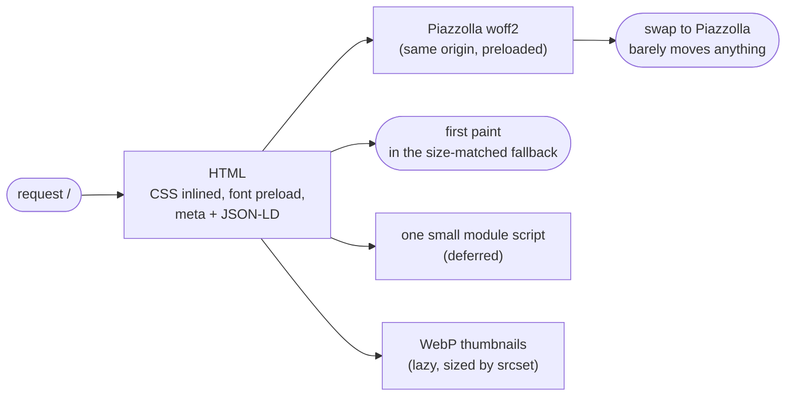

# Performance and SEO

How the site keeps Lighthouse happy: fast first paint (LCP), nothing jumping around (CLS), and the metadata search engines and link previews read.

## Table of Contents

- [Where it lives](#where-it-lives)
- [The big picture](#the-big-picture)
- [Fonts](#fonts)
    - [Fallback fonts](#fallback-fonts)
- [CSS](#css)
- [Images](#images)
- [JavaScript](#javascript)
- [Layout shift](#layout-shift)
    - [Collapsed sections and CLS](#collapsed-sections-and-cls)
- [Metadata](#metadata)
    - [Social cards](#social-cards)
        - [How the default card is built](#how-the-default-card-is-built)
    - [Structured data](#structured-data)
    - [llms.txt](#llmstxt)
    - [Sitemap and robots.txt](#sitemap-and-robotstxt)
- [Deploy](#deploy)
- [Measuring it](#measuring-it)
    - [Last run](#last-run)
- [Not built yet](#not-built-yet)
- [Navigation](#navigation)

## Where it lives

| File | Job |
| --- | --- |
| [astro.config.mjs](../astro.config.mjs) | The self-hosted font, `inlineStylesheets: 'always'`, the site URL |
| [Base.astro](../src/layouts/Base.astro) | `<Font>` preload, title, description, canonical, Open Graph, Twitter card, JSON-LD |
| [index.astro](../src/pages/index.astro), [[id].astro](../src/pages/projects/[id].astro) | Responsive `<Image>`s, per-page descriptions and social cards |
| [sitemap.xml.ts](../src/pages/sitemap.xml.ts) | The sitemap |
| [og.png.ts](../src/pages/og.png.ts), [socialCard.ts](../src/lib/socialCard.ts) | The default social card, built at build time |
| `public/robots.txt` | Crawl rules |
| [deploy.yml](../.github/workflows/deploy.yml) | Build and deploy on push to `main` |

## The big picture



## Fonts

Piazzolla comes from Google Fonts, but it's **downloaded at build time** by Astro's `fonts` config and served from this site. That does three things:

- **No third-party request on the critical path.** Before, the browser had to fetch CSS from fonts.googleapis.com and then the font from fonts.gstatic.com before any text could be drawn in Piazzolla.
- **A preload.** `<Font preload={[{ style: 'normal' }]} />` adds a `<link rel="preload">` for the upright face, which draws the `<h1>` and the body. The headline types itself in, so the hero paragraph may be the LCP element instead; check it in PageSpeed after deploy. The italic face isn't preloaded, but the home page needs it on first view (the wireframe caption, project status lines and stack lines are italic), so it shows up in PageSpeed's critical request chain: it's found once the HTML is parsed, rather than at the start. Preloading it too would make it arrive sooner, but it would compete with the upright face for bandwidth on slow phones. For now it isn't preloaded.
- **Size-matched fallbacks.** With `font-display: swap`, text paints straight away in a local serif, then swaps to Piazzolla when it arrives. The fallbacks are scaled so the lines wrap in the same places, and the swap doesn't move the layout. See [Fallback fonts](#fallback-fonts).

The font is variable. The config asks for weights 300 to 600 (what the site uses) and the optical-size axis (8 to 30), which `font-optical-sizing: auto` uses to adjust letterforms by size. That's one file per style, about 50 KB each.

### Fallback fonts

The `@font-face` rules are at the top of [global.css](../src/styles/global.css). Astro's generated fallback is off (`optimizedFallbacks: false`) because it fell short twice. On 2026-11-13 the live site scored **CLS 0.265** on PageSpeed:

- **It only covers Times New Roman,** which Linux (where PageSpeed runs) and Android don't have. They fell through to their default serif at its natural size.
- **Its size was computed, not measured,** and came out about 4% narrow even where Times exists.

There are three fallback families, so every common platform has one:

| Family | Matches | Covers |
| --- | --- | --- |
| `Piazzolla fallback Times` | Times New Roman, Liberation Serif, Tinos (all the same metrics) | Windows, macOS, iOS, most Linux, ChromeOS |
| `Piazzolla fallback Noto` | Noto Serif | Android, some Linux |
| `Piazzolla fallback DejaVu` | DejaVu Serif | Other Linux |

**Why they're split by weight.** Piazzolla's optical sizing makes small text relatively wider than large text. For the Times fallback, a 15px line needs a `size-adjust` of 112% and a 30px line needs 103%, and one `@font-face` can only have one value. The site's light weights are only used for display text, so each family has:

- a **300–350** face for the headlines, tuned until the home headline breaks onto the same lines as Piazzolla at 412, 600, 900, 1100 and 1350px wide;
- a **351–600** face and an **italic** face, measured at the 19px body size.

`ascent-override` and `descent-override` are Piazzolla's (1110 and 310 per 1000) divided by `size-adjust`.

**The `<h1>`'s width is in `em`, not `ch`.** `13ch` is measured from whichever font is showing, and the fallback's narrower "0" put the headline on an extra line until Piazzolla loaded. `7.82em` is the same 13 of Piazzolla's "0", in every font.

**Re-measure** when the hero copy, the body size, or the font changes. In Chrome, render a long line of the real copy at the real size and weight, once in Piazzolla and once in each fallback (`white-space: nowrap`), and divide the widths: that's `size-adjust`. Then compare the hero's element boxes at the widths above with the fonts blocked and not blocked, and nudge the light values until they match.

**What's left.** On a phone with a high pixel density, text widths round slightly differently, and a line of body text near its break point can still wrap one word differently. Lighthouse's mobile emulation (1.75× pixels) still measured CLS 0.16 from one line of `.proof`, down from 0.26. Layouts match exactly at 1× pixels.

## CSS

`build.inlineStylesheets: 'always'` puts all the CSS (about 10 KB) in a `<style>` in each page. A separate stylesheet would block first paint on an extra round trip; at this size, inlining is cheaper, even though it isn't cached across pages.

## Images

Covered in [content.md](content.md#screenshots). In short: Astro's `<Image>` makes WebP at the sizes each spot needs, with `srcset` and `sizes` so a phone never downloads the desktop file. The terminal screenshot went from a 147 KB PNG to a 4 KB thumbnail. Project-page screenshots load with `fetchpriority="high"`, and home page thumbnails are lazy.

## JavaScript

There's very little, and none of it blocks rendering:

- **The theme script** is a few bytes, inline in the `<head>`. It has to run before paint (see [site-shell.md](site-shell.md#no-flash-on-load)).
- **Base's script** (theme toggle, menu) and **the wireframe** are module scripts, which are deferred by default. Astro inlines Base's because it's tiny. The wireframe module is about 6 KB and loads as a file.
- The wireframe's loop only runs while something moves, and stops while the canvas is off screen ([wireframe.md](wireframe.md#when-the-loop-runs)).

## Layout shift

Things that would make content jump, and how each is held still:

| Would shift | Held by |
| --- | --- |
| Font swap | The size-matched fallbacks ([Fallback fonts](#fallback-fonts)) |
| Images loading | `width`/`height` from the source file, plus CSS `aspect-ratio` on thumbnails |
| The wireframe canvas | `aspect-ratio: 1` |
| The typewriter headline | Every letter is laid out from the start and only made visible, see [site-shell.md](site-shell.md#the-typewriter-headline) |
| The spin button appearing | Its space is reserved with `visibility: hidden` until the script runs |
| Theme applied late | The inline pre-paint theme script |
| Opening a project's "Technical details" | Nothing needed: see below |

### Collapsed sections and CLS

A project's "Technical details" section ([content.md](content.md#technical-details)) is a `<details>` that pushes the page down when opened. That doesn't count as layout shift: CLS leaves out any shift within about 500 ms of a click, tap or keypress (the `hadRecentInput` flag on each layout-shift entry), because the person asked for it. Two rules keep it that way:

- **It starts closed in the HTML, and no script opens it.** An open triggered by a script after load would count.
- **It opens instantly.** Only the 150 ms chevron turn animates, never the height, so no shift lands after the 500 ms window.

**Measured on 2026-11-27,** on VectorRAGNuxt from a production build: Lighthouse mobile gave Performance 100, Accessibility 100 and CLS 0. A Playwright check opened the section by click, then closed and reopened it by keyboard. It recorded 3 layout shifts, all flagged as user input, so none counted.

## Metadata

Every page gets, from [Base.astro](../src/layouts/Base.astro):

- **`<title>`:** "Clark Hinchcliff – Frontend Engineer" on the home page, "Project – Clark Hinchcliff" elsewhere. The home title is the line most people see first in search results and link previews, so it says what the job is, not just the name.
- **`<meta name="description">`:** the project's `summary`, or the home page's own description.
- **`<link rel="canonical">`:** the page's absolute URL, so crawlers treat it as the one true address.
- **`<html lang="en">`.**

### Social cards

Open Graph and Twitter tags (`og:title`, `og:description`, `og:url`, `og:type`, `og:image`, `og:image:alt`, `twitter:card = summary_large_image`) control the preview when a link is shared.

- **Project pages** use their screenshot, converted to JPEG by `getImage` in [[id].astro](../src/pages/projects/[id].astro), with the project's `imageAlt`.
- **Everything else** uses `/og.png`: 1200×630, the name and tagline in Piazzolla next to the icosahedron.

`og:type` is `profile` on the home page and `article` on project pages.

#### How the default card is built

The card is made on every build by [og.png.ts](../src/pages/og.png.ts), a static endpoint, so it's never a file someone has to remember to regenerate. What's on it lives in [socialCard.ts](../src/lib/socialCard.ts):

- **The tagline is one constant.** It feeds both the card and `og:image:alt` in Base.astro, so the image and its description can't disagree. To change the copy, edit `TAGLINE` and build.
- **The solid is the hero's solid.** It uses `icosahedron()`, the quaternion math, the camera and the depth fade (`DEPTH`, `nearness`, `depthAlpha`) from [geometry.ts](../src/scripts/geometry.ts), the same module the [wireframe](wireframe.md) draws from. Back edges and dots fade to 20% on both.
- **One difference from the hero, on purpose: dot size.** The hero's shader shrinks back dots to 55%, but the card keeps every dot the same size, as the original card did. Shrinking them moved the render further from the original and made the front vertices look flat.
- **Drawn back to front.** The card's colors are solid (pre-blended over the background), so whatever is drawn last covers whatever is under it. Edges and dots are sorted together by depth, so nearer marks always sit on top. The hero doesn't need this, because its additive blending makes order irrelevant.
- **Colors are the dark theme's tokens.** A spec checks them against `global.css`, so a palette change can't leave the card behind.
- **The text is checked, not trusted.** If Pango can't load Piazzolla, it quietly falls back to another font. A spec renders each line twice, once as written and once with a font name that can't exist, and fails if the widths match. It also checks that the rendered text ends before the solid begins.

**Why the text and the solid are drawn differently.** sharp has two ways to draw text, and only one handles a variable font properly:

| Renderer | Weight 330, optical size 30 | Used for |
| --- | --- | --- |
| SVG `<text>` (librsvg) | Snaps to the nearest named weight (300) and ignores `font-variation-settings`, so the headline comes out heavier | The background and the solid, which have no text |
| `text` input (Pango) | Takes exact axis values: `font_desc="Piazzolla 84 @wght=330,opsz=30"`. The size goes before the axes. | The two lines of text, composited onto the SVG |

**Why the fonts are TTFs in `src/assets/fonts/`.** sharp's bundled FreeType can't read woff2, so the site's own font files are no use to it. The TTFs are Piazzolla's variable fonts from Google Fonts, kept with their `OFL.txt` license. They're read at build time and never shipped, because nothing imports them.

**Checking a change:** run `pnpm build` and open `dist/og.png`. The sizes and positions in `TEXT` were fit pixel by pixel to the original hand-made card (mean difference 1.5 out of 255 per channel), so a change that isn't meant to move anything shouldn't.

### Structured data

JSON-LD (schema.org) is built by [structuredData.ts](../src/lib/structuredData.ts), and each page passes its own to `Base`:

- **The home page** describes a `Person` (name, job title, GitHub and LinkedIn as `sameAs`, and skills as `knowsAbout`) and the `WebSite`, linked by `@id`. This is what lets search engines and AI assistants connect the site, the profiles and the skills.
- **Each project page** describes a `SoftwareSourceCode`: name, summary, page URL, repo as `codeRepository`, the stack as `keywords`, and the same `Person` as `author`. It's built from the project's frontmatter, so it never needs writing by hand.

**Structured data only repeats what the pages show.** Hidden claims meant for machines (keyword lists, skills no page backs up) are what search engines treat as spam. A spec enforces this: every `knowsAbout` entry in [site.ts](../src/lib/site.ts) has to appear in some project's visible text, so adding a skill means showing it first.

It's escaped before it's written into the page, see [security.md](security.md#structured-data).

### llms.txt

`/llms.txt` is a Markdown summary of the site for AI assistants, following the [llmstxt.org](https://llmstxt.org/) proposal: an H1, a one-line summary, then each project with its summary, status, page and repo. [llms.txt.ts](../src/pages/llms.txt.ts) builds it from the project collection on every build (the text comes from [llmsTxt.ts](../src/lib/llmsTxt.ts)), so it can't fall behind the pages.

It also makes Lighthouse's Agentic Browsing audit predictable. Without the file, the audit depended on how GitHub Pages answered a missing file: a 404 passed as "not applicable," but a one-off 503 failed it (2026-11-18).

### Sitemap and robots.txt

- **`/sitemap.xml`** is a 10-line endpoint rather than `@astrojs/sitemap`: it lists the home page and every project. New projects show up on their own.
- **`/robots.txt`** allows everything and points to the sitemap.
- Every page also has `<link rel="sitemap">`.

## Deploy

[deploy.yml](../.github/workflows/deploy.yml) runs on push to `main` (or by hand). `withastro/action` installs with pnpm, at the version pinned by `packageManager` in `package.json` (the workflow deliberately doesn't set one too: if the two ever differed, the run would fail), and runs `pnpm build`, which runs the specs, `astro check`, the build and the CSP check, in that order. Any failure stops the deploy. `actions/deploy-pages` publishes `dist/`.

The workflow's permissions are the minimum Pages needs: `contents: read`, `pages: write`, `id-token: write`.

## Measuring it

Lighthouse needs Chrome. Either:

- run PageSpeed Insights (pagespeed.web.dev) on the live URL, or
- `pnpm build && pnpm preview`, then Lighthouse against the preview. Don't measure `pnpm dev`: it's unbundled and unoptimized. Without desktop Chrome, Playwright's headless shell works:

  ```bash
  CHROME_PATH=~/.cache/ms-playwright/chromium_headless_shell-*/chrome-headless-shell-linux64/chrome-headless-shell \
    pnpm dlx lighthouse http://localhost:4321/ --chrome-flags="--headless=new" --view
  ```

### Last run

2026-11-12, mobile preset, against the local preview. The home page was rerun on 2026-11-13 after the CSP and font changes.

| Page | Performance | Accessibility | Best Practices | SEO | Agentic Browsing |
| --- | --- | --- | --- | --- | --- |
| `/` (2026-11-13) | 99 | 100 | 100 | 100 | 100 |
| `/projects/smackhem/` (2026-11-12) | 100 | 100 | 100 | 92 | – |

Agentic Browsing counts a missing `/llms.txt` or ARD manifest as "not applicable" once Lighthouse can fetch them. The site now has an `/llms.txt` anyway ([why](#llmstxt)).

CLS is 0 and LCP is 0.6–1.6 s on both. Two things to know when reading the numbers:

- **SEO 92 came from the CSP.** Lighthouse's `robots-txt` audit fetches `/robots.txt` from inside the page, and `connect-src 'none'` blocked it. On 2026-11-13 it became `connect-src 'self'` ([why](security.md#the-directives)), which lets the audit run.
- **Home page blocking time (100–240 ms) is the wireframe's WebGL setup**: a couple of 100–150 ms tasks at startup. The headless shell draws WebGL in software, under a 4× CPU slowdown, so this overstates a phone with a GPU. The idle spin isn't the cause: with reduced motion forced on (no loop), blocking time was the same or higher. Its main-thread work comes in small frames that don't block.

## Not built yet

- **Long cache lifetimes.** GitHub Pages sets its own cache headers (10 minutes), even for hashed files in `/_astro/`. That only matters for repeat visits.

## Navigation

- **[Index](INDEX.md)** - Overview and documentation map
- **[Project Structure](project-structure.md)** - Where every file lives and why, plus testing
- **[Site Shell](site-shell.md)** - The layout: theme, header, footer, learning menu, accessibility
- **[Wireframe](wireframe.md)** - The hero icosahedron: math, rendering, motion and input
- **[Content](content.md)** - Projects as Markdown, screenshots, alt text, adding a project
- **[Security](security.md)** - CSP, referrer policy, external links, the CSP check
