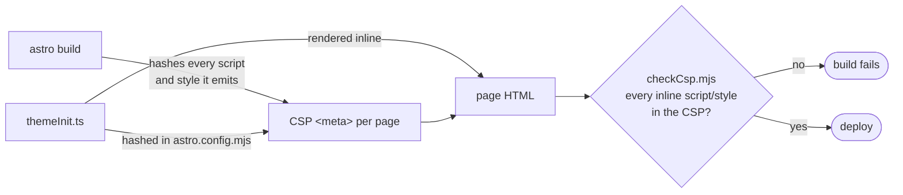

# Security

A static site with no forms, no accounts, no cookies and no third-party scripts has a small attack surface. What's left is mostly about two things: not running script we didn't write, and not leaking where visitors came from.

## Table of Contents

- [Where it lives](#where-it-lives)
- [The big picture](#the-big-picture)
- [Content Security Policy](#content-security-policy)
    - [Why a meta tag](#why-a-meta-tag)
    - [The directives](#the-directives)
    - [Hashes](#hashes)
    - [The inline theme script](#the-inline-theme-script)
    - [The CSP check](#the-csp-check)
    - [Testing it](#testing-it)
- [Referrer policy](#referrer-policy)
- [External links](#external-links)
- [Structured data](#structured-data)
- [Everything else we checked](#everything-else-we-checked)
- [Rules it follows](#rules-it-follows)
- [Not built yet](#not-built-yet)
- [Navigation](#navigation)

## Where it lives

| File | Job |
| --- | --- |
| [astro.config.mjs](../astro.config.mjs) | `security.csp`: the directives, plus the theme script's hash |
| [themeInit.ts](../src/lib/themeInit.ts) | The one inline script Astro doesn't hash, shared by the page and the config |
| [checkCsp.mjs](../scripts/checkCsp.mjs) | Post-build gate: fails if any inline script or style isn't allowed by the CSP |
| [Base.astro](../src/layouts/Base.astro) | The referrer policy, profile link `rel`s, the escaped JSON-LD |
| [externalLinks.ts](../src/lib/externalLinks.ts) | `EXTERNAL_REL` and `PROFILE_REL` |

## The big picture



## Content Security Policy

A CSP tells the browser which scripts, styles, fonts and images a page is allowed to load or run. If someone ever managed to get markup into a page (a bad dependency, a pasted snippet), the browser would refuse to run any script that isn't on the list.

### Why a meta tag

The usual way to send a CSP is an HTTP header, but GitHub Pages doesn't let us set headers. Browsers also accept a CSP in `<meta http-equiv="content-security-policy">`, with a few directives ignored in that form: `frame-ancestors`, `report-uri` and `sandbox`.

Astro's `security.csp` (stable since Astro 6) writes that meta tag into every page.

### The directives

```
default-src 'self'      anything not listed below: same origin only
img-src 'self'          images: same origin only
font-src 'self'         fonts: same origin only (they're self-hosted)
connect-src 'self'      fetch, XHR and WebSocket to this site only; the site's own code makes none
object-src 'none'       no plugins (<object>, <embed>)
base-uri 'self'         a planted <base> can't redirect relative URLs elsewhere
form-action 'none'      there are no forms, so nothing may submit one
script-src 'self' 'sha256-…'   same-origin files, plus inline scripts by exact hash
style-src  'self' 'sha256-…'   same-origin files, plus inline styles by exact hash
```

There's no `'unsafe-inline'` and no `'unsafe-eval'`. Those are the two things that make most CSPs toothless.

**Why `connect-src` is `'self'` and not `'none'`.** The site never fetches anything, so `'none'` was the tightest setting. But Lighthouse fetches `/robots.txt` and `/llms.txt` from inside the page, so `'none'` blocked its audits and cost the SEO and Agentic Browsing scores (changed 2026-11-13). `'self'` only allows requests back to this site, so it opens no way to send data elsewhere. A script that could misuse it would first have to get past `script-src`, which still allows only same-origin files and hashed inline scripts.

### Hashes

An inline `<script>` or `<style>` is allowed only if the SHA-256 hash of its exact contents is in the policy. Astro computes these at build time for every script and style it processes: the bundled component scripts, the scoped styles, the inlined global CSS, and the `@font-face` rules from the `<Font>` component.

A consequence: **inline `style=""` attributes are blocked**, because hashes in `style-src` only cover `<style>` elements. Don't use them.

### The inline theme script

The pre-paint theme script has to be inline (see [site-shell.md](site-shell.md#no-flash-on-load)), and Astro doesn't hash `is:inline` scripts. Left alone, the browser would block it, and saved themes would quietly stop working.

So the script is one string, `THEME_INIT` in [themeInit.ts](../src/lib/themeInit.ts):

- [Base.astro](../src/layouts/Base.astro) renders it with `<script is:inline set:html={THEME_INIT} />`.
- [astro.config.mjs](../astro.config.mjs) imports the same string, hashes it with `node:crypto`, and adds it to `scriptDirective.hashes`.

Change the string and both follow. Editing the script anywhere else (say, inline in the template) would break the match, and the CSP check would catch it.

### The CSP check

A CSP mistake doesn't break the build. It breaks the page in the browser, silently. So `pnpm build` ends with [checkCsp.mjs](../scripts/checkCsp.mjs), which runs [cspAudit.ts](../src/lib/cspAudit.ts) over every page in `dist/` and fails if:

- a page has no CSP meta tag,
- an inline `<script>` or `<style>` isn't allowed by its page's hashes (scripts with `src` and non-running `application/ld+json` are skipped),
- a `style` attribute appears, however it's quoted,
- an inline event handler appears (`onclick=`, `onload=`, any `on*`), or
- a `javascript:` URL appears in `href`, `src`, `action` or `formaction`.

The attribute checks only look inside real start tags, with attribute values matched whole. So the same words in prose, comments, alt text or a script body don't fail the build. The rules have specs in [cspAudit.spec.ts](../src/lib/cspAudit.spec.ts), including those near misses, so a regex that quietly stops matching turns `pnpm test` red instead of passing every page.

### Testing it

The CSP isn't applied in `pnpm dev` (Vite's dev server injects its own scripts). To see it working, use `pnpm build && pnpm preview` and watch the browser console: a blocked script or style shows up there as a CSP violation.

## Referrer policy

```html
<meta name="referrer" content="no-referrer" />
```

When a visitor follows a link off the site, or the page loads anything, the browser sends no `Referer` header. Destination sites can't see which page someone came from. This covers every link on the site, including the ones in Markdown write-ups, which can't easily carry a `rel` attribute.

The trade-off: GitHub and LinkedIn can't tell that a visitor came from the portfolio.

## External links

Template links that leave the site get `rel` from [externalLinks.ts](../src/lib/externalLinks.ts):

- **`EXTERNAL_REL = 'noopener noreferrer'`** on the learning menu links and each project's repo link.
  - `noopener` stops the destination page from getting a handle to this window (`window.opener`) and redirecting it, an attack called reverse tabnabbing. That attack needs `target="_blank"`, which the site doesn't use, so this is belt and braces.
  - `noreferrer` drops the `Referer` header for that link, which the page-wide policy already does.
- **`PROFILE_REL = 'me noopener noreferrer'`** on the GitHub and LinkedIn links. `me` says "this profile is also me", which lets sites that support it (like Mastodon) verify the link, and helps search engines tie the profiles to the site.

Markdown links don't get `rel`. Astro 7's Markdown processor (Sätteri) would need an extra package and a plugin for that, and the referrer policy already covers what `noreferrer` would do. If a write-up ever needs `target="_blank"`, write the link as HTML with `rel="noopener noreferrer"`.

## Structured data

The JSON-LD in the home page `<head>` is written with `set:html`, which doesn't escape anything. `JSON.stringify` doesn't escape `<` either, so a string containing `</script>` could close the element early and inject markup. The data is our own constants today, but it's escaped anyway (`<` becomes `<`), so it stays safe if it's ever generated from content.

## Everything else we checked

- **HTTPS:** enforced in **Settings → Pages**. Checked 2026-11-16: `http://clarkhinchcliff.com/` and `http://www.clarkhinchcliff.com/` both answer with a 301 to `https://clarkhinchcliff.com/`.
- **No third parties at runtime:** no CDNs, analytics, embeds or remote fonts, so there's nothing to pin with Subresource Integrity.
- **No user input:** no forms, query parameters or cookies are read. The only stored value is the theme, and the theme script only accepts `'light'` or `'dark'`.
- **Content is trusted:** Markdown can contain raw HTML, which is fine because only Clark writes it. Don't render Markdown from anyone else without sanitizing it.
- **Dependencies:** `pnpm audit` was clean on 2026-11-11. The lockfile is committed, and CI installs from it. [Dependabot](../.github/dependabot.yml) opens weekly PRs: one for Astro and `@astrojs/*`, one for the other dev tools, and one for the deploy workflow's actions. Major versions of `@types/node` and `typescript` are skipped on purpose (see the comments in the file).
- **CI permissions:** the deploy workflow asks for the minimum (`contents: read`, `pages: write`, `id-token: write`).

## Rules it follows

- **No `'unsafe-inline'`, no `'unsafe-eval'`.**
- **No inline `style=""` attributes,** and no new inline scripts outside `themeInit.ts`.
- **No new origins** without adding them to the directives on purpose (and asking whether it's worth it).
- **No syntax highlighting with Shiki.** It uses inline styles. Highlighting is off today; if code blocks are needed, use Prism, then check the CSP still passes.
- **External template links use `EXTERNAL_REL` or `PROFILE_REL`.**

## Not built yet

These need either HTTP headers, which GitHub Pages can't send, or a decision:

- **Clickjacking protection.** `frame-ancestors` and `X-Frame-Options` only work as headers. The risk is low: there's nothing on the site to trick someone into clicking. Moving to a host with header control (Cloudflare Pages, Netlify) would fix it.
- **Other headers:** `Strict-Transport-Security`, `X-Content-Type-Options: nosniff`, `Permissions-Policy`, `Cross-Origin-Opener-Policy`. GitHub Pages sends none of them (checked 2026-11-11).
- **CSP violation reports.** These need `report-to`, which is header-only.
- **Pinning GitHub Actions to commit SHAs** instead of version tags, so a hijacked tag can't change what runs in CI. Clark's call: it trades safety for manual updates.

## Navigation

- **[Index](INDEX.md)** - Overview and documentation map
- **[Project Structure](project-structure.md)** - Where every file lives and why, plus testing
- **[Site Shell](site-shell.md)** - The layout: theme, header, footer, learning menu, accessibility
- **[Wireframe](wireframe.md)** - The hero icosahedron: math, rendering, motion and input
- **[Content](content.md)** - Projects as Markdown, screenshots, alt text, adding a project
- **[Performance and SEO](performance-seo.md)** - Fonts, images, CSS, metadata, sitemap, deploy
