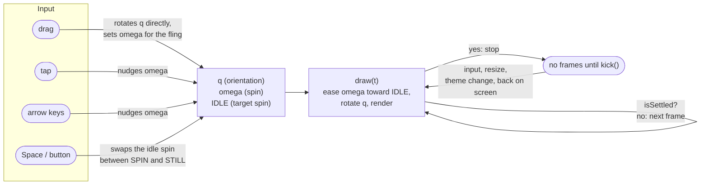

# Wireframe

The rotating icosahedron in the home page hero. It's drawn with WebGL 2 and about 60 lines of hand-written matrix and quaternion math, no 3D library.

## Table of Contents

- [Where it lives](#where-it-lives)
- [The big picture](#the-big-picture)
- [The shape](#the-shape)
- [From vertex to pixel](#from-vertex-to-pixel)
    - [Rotation as a quaternion](#rotation-as-a-quaternion)
    - [The matrices](#the-matrices)
    - [Shaders: depth without a depth buffer](#shaders-depth-without-a-depth-buffer)
- [Motion](#motion)
    - [The spin model](#the-spin-model)
    - [When the loop runs](#when-the-loop-runs)
    - [The entrance](#the-entrance)
- [Input](#input)
- [Theme changes](#theme-changes)
- [When WebGL fails](#when-webgl-fails)
- [Rules it follows](#rules-it-follows)
- [Not built yet](#not-built-yet)
- [Navigation](#navigation)

## Where it lives

| File | Job |
| --- | --- |
| [Wireframe.astro](../src/components/Wireframe.astro) | The figure: canvas, caption, the Stop/Start spinning button, and their styles |
| [wireframe.ts](../src/scripts/wireframe.ts) | `mountWireframe`: WebGL 2 setup, the math, the render loop, input |
| [motion.ts](../src/scripts/motion.ts) | The motion rules (`easeToward`, `isSettled`) and input rules (`classifyRelease`, `tapDirection`, `capSpin`, `nudge`, and their thresholds), free of WebGL and the DOM so they can be tested |
| [motion.spec.ts](../src/scripts/motion.spec.ts) | Specs for those rules, including each threshold's edges |

**State lives in two numbers.** The solid's orientation is a quaternion `q`, and its spin is an angular velocity `omega` (radians per second around each axis). Input changes `omega` (or `q` directly while dragging), and each frame turns `omega` into a small rotation applied to `q`.

## The big picture



## The shape

An icosahedron has 12 vertices and 30 edges. The vertices are the corners of three golden rectangles, one in each plane, with sides 2 and 2φ (φ is the golden ratio, about 1.618):

```
(0, ±1, ±φ)   (±1, ±φ, 0)   (±φ, 0, ±1)
```

Rather than typing out the 30 edges, `icosahedron()` finds them: two vertices share an edge exactly when they are 2 apart, and no other pair is that close. Squared distances are compared against 4 with a small tolerance, so there's no square root.

The vertices are then divided by `√(1 + φ²)` so they sit on a unit sphere, which keeps the camera math simple.

## From vertex to pixel

### Rotation as a quaternion

The orientation is a unit quaternion `[x, y, z, w]` rather than three Euler angles, for two reasons:

- **No gimbal lock.** With Euler angles, some orientations lose a degree of freedom and drags start to feel stuck. Quaternions don't have that problem.
- **Rotations compose by multiplying.** A drag, a fling and the idle spin are each "rotate a little about some axis". `qaxis(axis, angle)` builds that small rotation, and `qmul(small, q)` applies it on top of the current one. Multiplying on the left means the rotation happens in screen space, so dragging right always turns the front face right, however the solid is already turned.

Floating-point error slowly pulls a quaternion off unit length, which would start to scale the shape. `qnorm` renormalizes after every multiply.

### The matrices

Each frame builds one model-view-projection matrix (all column-major, like WebGL expects):

```
mvp = perspective(fov 0.68 rad, aspect, near 0.1, far 10) × translate(z = -3.4) × rotation(q) × scale(s)
```

- `qmat(q)` turns the quaternion into a 4×4 rotation matrix.
- The translation is written straight into the matrix (z = -3.4), which pushes the solid back from the camera at the origin.
- `scale` is only for the entrance (below). After that it's 1. It's the same on every axis, so there's no scale matrix: the rotation's first three columns are multiplied by `s`.

**The loop allocates nothing.** The projection only depends on the canvas's shape, so it's built in `resize()`. Each frame writes into three reused `Float32Array`s (rotation, model, MVP) instead of creating new ones, so a phone's garbage collector isn't kept busy by an idle spin.

The rotation matrix is also passed to the vertex shader on its own (`u_rot`), so the shader knows how near each vertex is to the viewer.

### Shaders: depth without a depth buffer

There's no depth buffer. Instead, the vertex shader computes how near each vertex is (`v_near`, 0 at the back, 1 at the front, from the rotated z), and the fragment shader fades by it:

- **Edges** fade from 20% at the back to 100% at the front. That's enough for your eye to read which edges are in front, and it's cheaper and softer than depth testing.
- **Vertices** are drawn as `POINTS` and cut into circles in the fragment shader (discarding fragments outside a radius of 0.5 around the point's center). They also shrink toward the back.

Blending uses premultiplied alpha (`ONE, ONE_MINUS_SRC_ALPHA`), and the shader outputs premultiplied color, so overlapping faint edges add up without dark fringes.

The canvas is sized to its CSS size times the device pixel ratio, capped at 2. Point sizes are scaled by the same ratio so they look the same on every screen.

## Motion

### The spin model

`omega` is always easing toward a target, `IDLE`:

- **Spinning:** `IDLE = SPIN`, a slow tumble of `[0.1, 0.28, 0.04]` rad/s.
- **Stopped:** `IDLE = STILL`, which is zero.

Each frame, `easeToward` moves `omega` a fraction `k = 1 − e^(−1.4·dt)` of the way to `IDLE`. That's exponential easing, so a hard fling slows down quickly at first and then gently, and it behaves the same at any frame rate. `dt` is capped at 50 ms, so a stalled tab doesn't produce one giant jump.

Then the frame's rotation is `|omega| × dt` radians around the `omega` axis, applied to `q`.

### When the loop runs

The loop only runs while something is moving, to save battery. `kick()` starts it if it isn't already running, and each frame asks `isSettled` whether to stop. The loop stops when all of these are true:

- the entrance is finished,
- nobody is dragging,
- the solid is still (`|omega|` below 1e-4 rad/s),
- **and** there's no idle spin to ease up to.

That last condition matters. The first frame after `kick()` always has `dt = 0`, so `omega` can't have moved yet. Without that check, "Start spinning" from rest saw a still solid on its first frame and stopped the loop straight away. The regression spec in `motion.spec.ts` covers it.

The loop also stops while the canvas is off screen (an `IntersectionObserver`), and starts again when it scrolls back into view.

### The entrance

On first load the solid grows from 72% to full size and fades in over 1.1 s, with a cubic ease-out. With reduced motion on, the entrance is skipped (`born = −Infinity`).

## Input

| Input | Effect |
| --- | --- |
| **Drag** | Rotates `q` directly. The axis is `[dy, dx, 0]` (perpendicular to the drag in screen space), and dragging the full canvas width turns it 180°. |
| **Release after a drag** | Keeps the drag's speed as a fling, capped at 6 rad/s. If the pointer was held still for more than 80 ms before letting go, there's no fling. |
| **Tap** (moved under 6 px, under 500 ms) | Nudges the spin 1.6 rad/s toward the tapped side, measured from the center. Taps within 8% of the center do nothing, because there's no clear direction. |
| **Arrow keys** (canvas focused) | The same 1.6 rad/s nudge, in that direction. The page doesn't scroll. |
| **Space** (canvas focused), or the button | Toggles the idle spin. Stopping sets `omega` to zero immediately rather than easing out. |
| **Vertical swipe** (touch) | Scrolls the page. The canvas has `touch-action: pan-y pinch-zoom`, so a phone visitor whose thumb lands on the hero can still scroll and zoom. A finger turns the solid with horizontal drags, and taps above or below the center turn it vertically. |

**One pointer at a time.** The first pointer down owns the drag (`activeId`). A second finger is ignored until the first one lifts, so it can't make the drag jump.

**A cancel is not a tap.** When the browser takes a touch to scroll the page, it sends `pointercancel`. `classifyRelease` returns `'cancel'` for that, never `'tap'`, so a quick swipe past the hero doesn't nudge the solid. The spin keeps going (capped) and eases back to idle.

## Theme changes

The edge color is the CSS custom property `--wire`. On `themechange` (dispatched by the toggle in [Base.astro](../src/layouts/Base.astro)), `setColor` reads the new value and the loop is kicked so the next frame draws in it.

## When WebGL fails

Every failure ends the same way, in `showFallback`: the figure gets `.no-gl`, which hides the canvas and the button (so the canvas's tab stop goes too), and the caption says what happened. Nobody is left on a blank canvas whose label describes controls that don't work.

| Failure | What happens |
| --- | --- |
| No WebGL 2 | `getContext` returns null: fallback, "This browser doesn't support WebGL 2…" |
| Shaders don't compile or link | `setupGL` throws (it checks `COMPILE_STATUS` and `LINK_STATUS`): fallback, "The wireframe couldn't start…" |
| GPU context lost (a phone reclaiming memory, a driver reset) | `webglcontextlost` is `preventDefault`ed, which asks for the context back, and the loop stops. On `webglcontextrestored`, `setupGL` rebuilds the program, buffers and vertex array, which the loss destroyed. `q` and `omega` live outside it, so the solid carries on where it was. If the rebuild fails: fallback. |

To try the lost-context path, run this in the console: `document.querySelector('#solid canvas').getContext('webgl2').getExtension('WEBGL_lose_context').loseContext()`, then call `.restoreContext()` on the same extension.

## Rules it follows

- **Pause, stop, hide (WCAG 2.2.2).** The idle spin starts on its own and lasts more than 5 seconds, so the Stop/Start spinning button and the Space key can stop it.
- **Dragging movements (WCAG 2.5.7).** Everything a drag does can also be done with a single tap, and with the keyboard.
- **Reduced motion.** With `prefers-reduced-motion`, the solid starts still, the entrance is skipped, and the button offers to start the spin instead.
- **Named for assistive tech.** The canvas has `role="img"` and a label that explains the controls. The button sits outside the `<figcaption>`, so it isn't read as part of the figure's name.
- **No layout shift.** The button's space is held from the first paint with `visibility: hidden` (not `display: none`) until the script is ready.
- **Degrades cleanly.** Without WebGL 2, or when the shaders fail, the canvas and button are hidden and the caption says why. A lost context is recovered. See [When WebGL fails](#when-webgl-fails).
- **Doesn't trap scrolling.** Touch scrolling and pinch-zoom pass through the canvas (`pan-y pinch-zoom`).

## Not built yet

- **A still image when WebGL 2 is missing**, instead of the caption-only fallback.
- **Pause when the tab is hidden.** `requestAnimationFrame` already stops in background tabs, so this hasn't been needed.

## Navigation

- **[Index](INDEX.md)** - Overview and documentation map
- **[Project Structure](project-structure.md)** - Where every file lives and why, plus testing
- **[Site Shell](site-shell.md)** - The layout: theme, header, footer, learning menu, accessibility
- **[Content](content.md)** - Projects as Markdown, screenshots, alt text, adding a project
- **[Performance and SEO](performance-seo.md)** - Fonts, images, CSS, metadata, sitemap, deploy
- **[Security](security.md)** - CSP, referrer policy, external links, the CSP check
